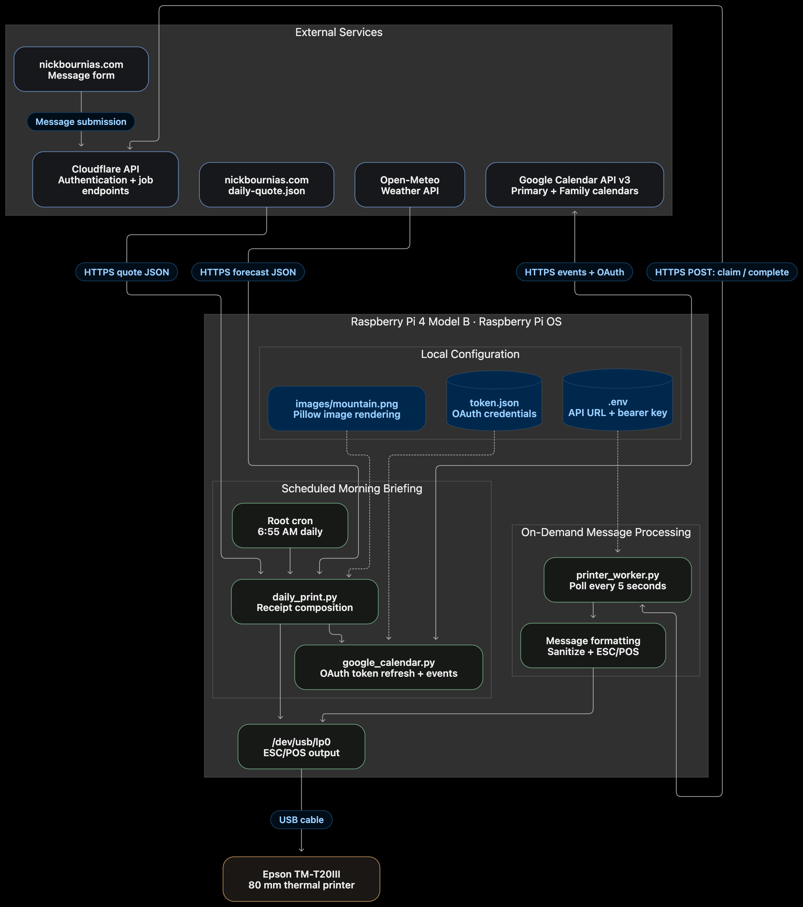

# The Daily Print 🧾

The Daily Print is a Raspberry Pi-powered thermal receipt printer project that turns digital information into small, tangible prints. It automatically prints a personalized morning briefing and receives on-demand messages from a web interface.

Built around an **Epson TM-T20III** thermal receipt printer and a **Raspberry Pi 4 Model B**, the project combines Python automation, cloud APIs, OAuth 2.0, and direct hardware communication.

## System Architecture

The system supports two independent printing workflows:

1. **Scheduled morning briefing:** A cron job runs a Python script that retrieves weather, calendar events, and a daily quote, formats them into a receipt, and sends it to the printer.
2. **On-demand messages:** Visitors submit messages through my website. A Cloudflare-backed API handles message delivery, while a Python worker on the Raspberry Pi polls for incoming print jobs.

Both workflows communicate with the printer over USB using ESC/POS commands.

The Raspberry Pi initiates outbound HTTPS requests to external services, so the printer doesn't need to be directly exposed to the public internet.

## What It Does

### ☀️ Daily Morning Receipt

Every morning at **6:55 AM**, a scheduled Python script generates a personalized receipt featuring:

- A randomized morning greeting
- Local Denver weather
- Today's events from Google Calendar, including a shared Family calendar
- A daily checklist with physical checkboxes
- A daily quote retrieved from my website
- Custom receipt formatting and graphics

The goal is to make the morning briefing useful without turning it into another screen to check.

### ✉️ Print Messages From the Web

A custom website interface lets visitors send short messages directly to my receipt printer.

These arrive as physical receipt-style slips, with distinctive formatting for incoming messages.

**Want to try it?** Send me a message at https://nickbournias.com/contact.

The web-to-printer workflow uses a Cloudflare API with bearer-token authentication. A Python worker running on the Raspberry Pi periodically checks for pending messages, prints them, and acknowledges completion.

## Hardware

| Component | Purpose |
| --- | --- |
| Raspberry Pi 4 Model B | Runs Python scripts, scheduled jobs, and the message worker |
| Epson TM-T20III | 80 mm thermal receipt printer |
| USB connection | Transfers ESC/POS print commands from the Pi to the printer |

## Software and Services

| Technology | Purpose |
| --- | --- |
| Python 3 | Receipt generation, API integrations, and printer communication |
| Raspberry Pi OS | Linux operating system |
| Pillow | Image rendering and receipt graphics |
| ESC/POS | Thermal printer command protocol |
| Linux cron | Automated daily printing |
| Google Calendar API | Personal and shared calendar events |
| OAuth 2.0 | Secure Google Calendar authorization |
| Open-Meteo API | Local weather forecasts |
| Cloudflare | Authenticated web-to-printer messaging |
| Git / GitHub | Source control |

## Getting Started

This is a personal project, so setup depends on your Raspberry Pi, printer configuration, and API credentials.

1. Connect a compatible USB thermal receipt printer to a Raspberry Pi.
2. Install Python 3 and the required dependencies.
3. Configure the printer device and test ESC/POS communication.
4. Set up Google Calendar API credentials if enabling calendar integration.
5. Configure any required environment variables and API credentials.
6. Run `daily_print.py` manually to verify the receipt.
7. Schedule the morning briefing using cron.
8. Optionally configure the Cloudflare API and `printer_worker.py` for remote message printing.

### Security

API keys, OAuth tokens, and local environment files are excluded from version control.

The project uses environment variables for printer API authentication and OAuth 2.0 credentials for read-only Google Calendar access.

The web-to-printer architecture relies on outbound polling rather than exposing the Raspberry Pi as a publicly accessible server.

## Design Philosophy

The Daily Print is deliberately simple:

- **Physical over digital:** A small paper receipt can feel more intentional than another notification.
- **Useful, not overwhelming:** Only a handful of things worth seeing each morning.
- **Playful formatting:** Receipt typography, compact graphics, and small details make ordinary information more fun.
- **Hackable by design:** New data sources and print formats can be added as the project evolves.

## Ideas for Future Prints

- Short, relevant articles with QR codes linking to the full text
- Weekly snowboarding conditions and mountain forecasts
- Grocery lists and shopping checklists
- Special holiday editions
- Additional custom receipt templates
